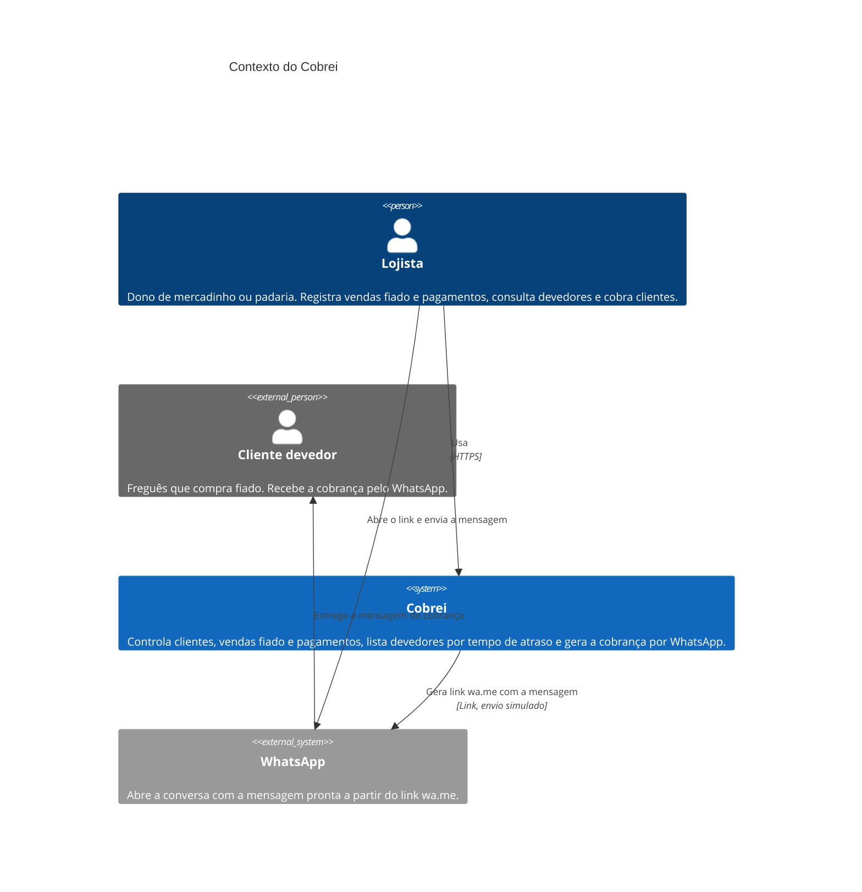
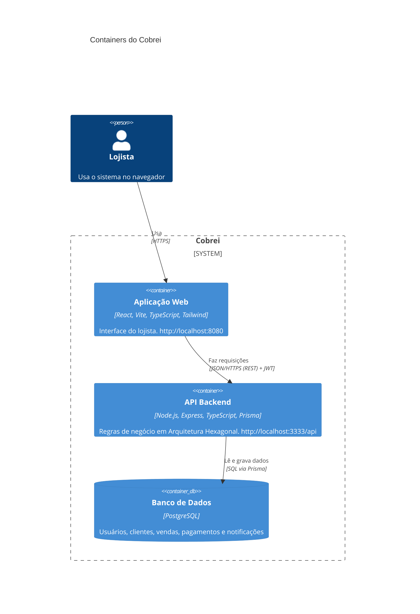
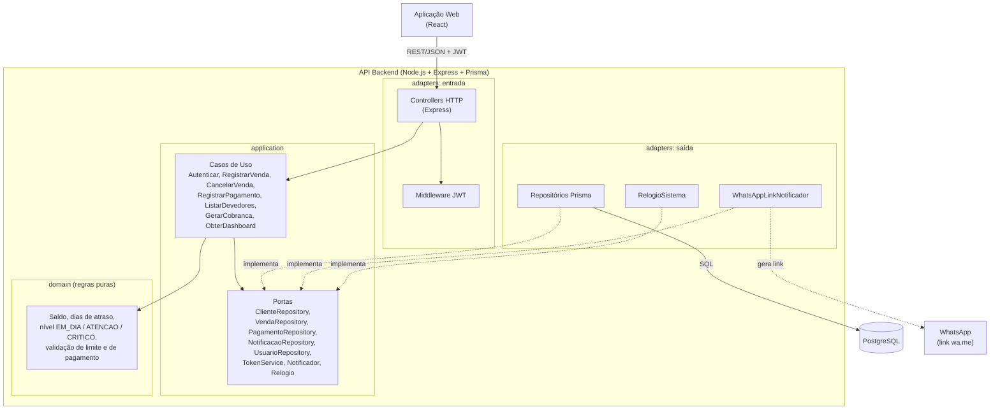
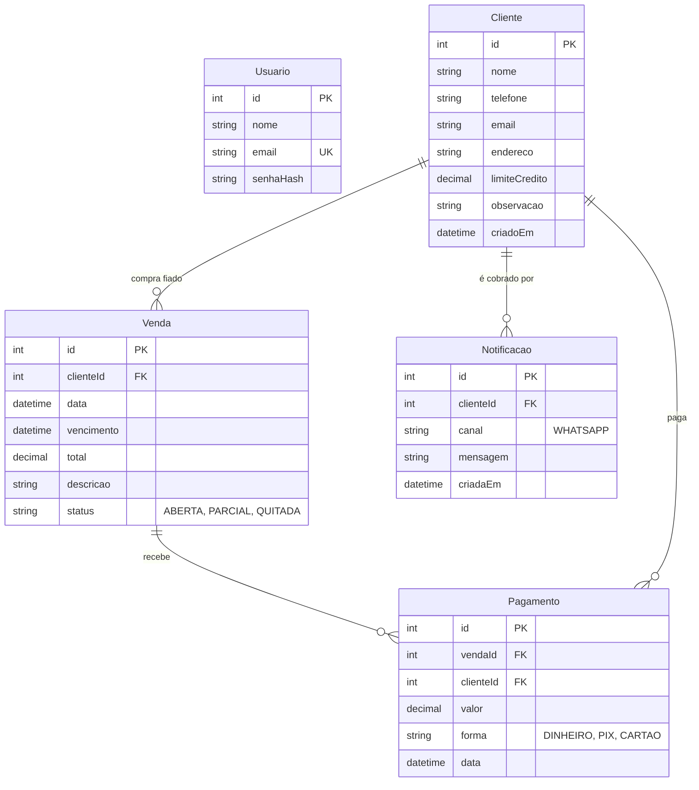
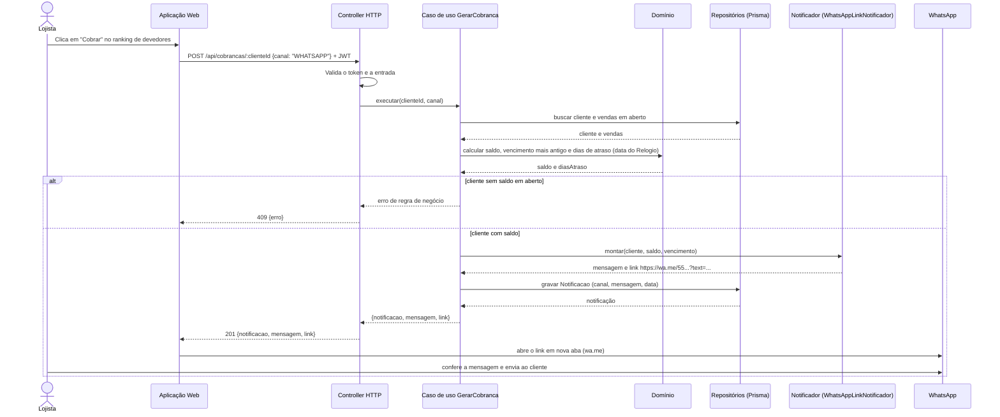

# Diagramas do Cobrei

Os mesmos diagramas do modelo [`workspace.dsl`](workspace.dsl) (Structurizr), em Mermaid para renderização direta no GitHub. Esta página inclui ainda o diagrama entidade-relacionamento e o diagrama de sequência da cobrança.

## 1. Contexto (C4 nível 1)

## 2. Containers (C4 nível 2)

## 3. Componentes da API (C4 nível 3)

A API segue a Arquitetura Hexagonal: os adaptadores dependem da aplicação, a aplicação depende do domínio, e o domínio não depende de ninguém.

## 4. Diagrama entidade-relacionamento

O saldo devedor não é armazenado: é calculado pelo domínio a partir das vendas e dos pagamentos.

`Usuario` (o lojista) não se relaciona com as demais entidades nesta versão, que atende a um único comércio. Com o multiusuário e multiloja (RF10), uma entidade `Loja` seria incluída e relacionada a todas elas.

## 5. Sequência: cobrança por WhatsApp

Fluxo de `POST /api/cobrancas/:clienteId` (UC06). A data de referência vem da porta `Relogio`, e o envio é simulado: o lojista abre o link e envia a mensagem.

